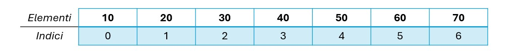

# Liste

Le **liste** sono insiemi di elementi che possiedono le seguenti caratteristiche:

* Gli elementi contenuti nella lista sono disposti in un certo ordine (casuale o definito)
* Gli elementi contenuti nella lista possono essere tipi di dato differenti
* Gli elementi contenuti nella lista possono essere ripetuti
* La lista è una struttura dati variabile nel tempo (può subire modifiche)

## Operazioni elementari

Per creare una lista vuota o inizializzata si può sfruttare l'operatore `[]` come mostrato di seguito:

```python
# Definizione e inizializzazione di liste
l1 = []
l2 = ["Mario", 15, "Mele", "Pere", 37]

# Stampa delle liste
print(empty_list)
print(my_list)
```

### Accesso e modifica di elementi

Si può accedere agli elementi della lista sfruttando la posizione o **indice** e l'operatore `[]`. Le liste sono **indicizzate a zero** ciò significa che il primo elemento è in posizione 0.



```python
# Definizione e inizializzazione di liste
l = ["Mario", 15, "Mele", "Pere", 37]

print(l[0])      # Stampa: 'Mario'
print(l[-1])     # Stampa: 37

l[0] = True
print(l)         # Stampa: [True, 15, "Mele", "Pere", 37]
```

### Iterazione

Iterare sulle liste significa socrrerne i valori elemento per elemento sfruttando un ciclo `for`. Le iterazioni possono essere di due tipologie:

* Iterazioni per **valore**:

```python
numeri = [1, 3, 5, 7, 9]

for val in numeri:
    print(val)
```

* Iterazioni per **indice**:

```python
numeri = [1, 3, 5, 7, 9]

for i in range(len(numeri)):
    print(i, numeri[i])
```

## Funzioni che si applicano sulle liste

Le seguenti funzioni possono accettare una lista come argomento:

* `len()`: ritorna il numero di elementi della lista
* `sum()`: ritorna la somma degli elementi della lista **se sono TUTTI numerici**.
* `max()`: ritorna l'elemento massimo della presente all'interno della lista.
* `min()`: ritorna l'elemento minimo della presente all'interno della lista.

```python
l = ["occhiali", "matita", "penna"]

print(len(l))           # Stampa: 3
print(max(l))           # Stampa: penna
print(min(l))           # Stampa: matita
```

## Metodi dell liste

I **metodi** sono funzioni proprie delle liste che permettono di modificarle (alterarne la struttura). Essi si applicano alla variabile che identifica la lista tramite l'operatore punto: `.nome_metodo()`

* `.append(e)`: permette di aggiungere l'elemento `e` in coda alla lista;
* `.insert(i, e)`: permette di aggiungere l'elemento `e` nella posizione di indice `i` della lista;
* `.pop(i)`: permette di rimuovere l'elemento all'indice `i` dalla lista e lo restituisce;
* `.remove(e)`: permette di rimuovere l'elemento `e` dalla lista;
* `.index(e)`: restituisce l'indice della prima occorrenza di `e` nella lista;
* `.sort()`: ordina la lista secondo il normale ordine crescente (per elementi dello stesso tipo);
* `.reverse()`: inverte l'ordine degli elementi della lista;
* `.count(e)`: restituisce il numero di occorrenze di `e` presenti nella lista;

## Slicing

Si dice *slicing* l'operazione di "taglio" di una lista considerando solamente una certa sua parte di elementi. In python è possibile effettuare
lo slicing di stringe tramite la sintassi `list[start:end]` dove `start` e `end` sono gli indici di un intervallo di elementi.

**NB**: Quando si effettua lo slicing si considera sempre la logica *primo incluso, ultimo escluzo* per gli indci `start` e `end`.

```python
lista = [10, 20, 30, 40, 50, 60]

sliced = lista[2:]                # [30, 40, 50, 60]
sliced = lista[2:5]               # [30, 40, 50]
sliced = lista[:5]                # [10, 20, 30, 40, 50]
sliced = lista[-3:]               # [40, 50, 60]
sliced = lista[:-3]               # [10, 20, 30]
```

**NB**: gli indici seguono la logica *primo incluso, ultimo escluso*.